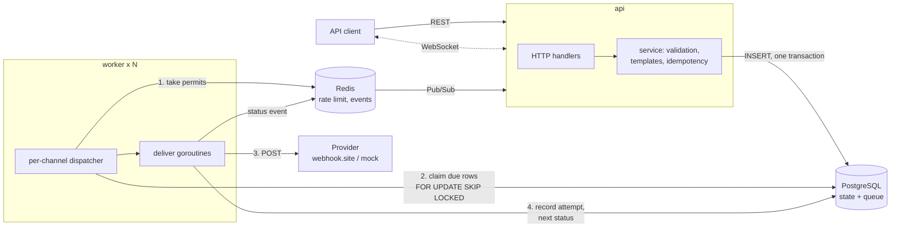
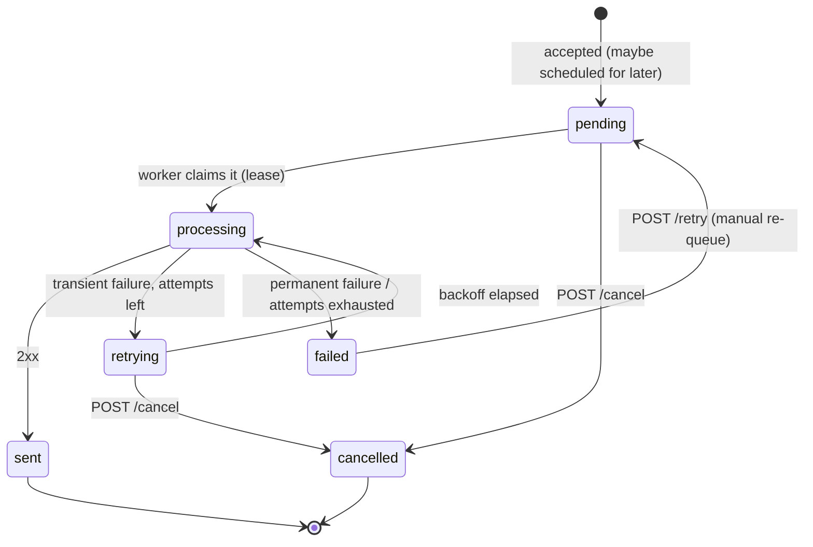

# Event-Driven Notification System

[](https://github.com/atakanakis/notification-engine/actions/workflows/ci.yml)

A Go service that accepts notification requests (SMS, email, push), queues them durably and
delivers them asynchronously, with a hard per-channel rate limit, priorities, retries with
backoff, a circuit breaker, a dead-letter state and real-time status tracking.

```
docker compose up --build
```

| What | Where |
|---|---|
| API + Swagger UI | http://localhost:8080/docs |
| OpenAPI spec | [`api/openapi.yaml`](api/openapi.yaml) (also served at `/openapi.yaml`) |
| Real-time metrics (JSON) | http://localhost:8080/v1/metrics |
| Prometheus | http://localhost:9095 (scrapes the API and every worker replica) |
| Jaeger (traces) | http://localhost:16686 |
| Mock provider stats | http://localhost:9090/stats |

**Contents:** [Quick tour](#quick-tour) · [Architecture](#architecture) ·
[Delivery and retry design](#delivery-and-retry-design) · [Rate limiting and priority](#rate-limiting-and-priority) ·
[Idempotency](#idempotency) · [Observability](#observability) · [Testing](#testing) ·
[webhook.site](#using-webhooksite-as-the-provider) · [Configuration](#configuration) ·
[Trade-offs and next steps](#trade-offs-and-what-i-would-do-next) · [How this was built](#how-this-was-built)

---

## Quick tour

```bash
# 1. Send one SMS (202 Accepted: queued, delivered asynchronously)
curl -s -X POST localhost:8080/v1/notifications \
  -H 'Content-Type: application/json' \
  -H 'Idempotency-Key: order-1001-shipped' \
  -H 'X-Correlation-ID: checkout-7f3a' \
  -d '{"recipient":"+905551234567","channel":"sms","content":"Your order has shipped","priority":"high"}'

# 2. Check its status, including every delivery attempt
curl -s localhost:8080/v1/notifications/<id>

# 3. Send the same request again: no duplicate, 200 + "Idempotent-Replayed: true"

# 4. Batch of up to 1000, then the batch summary
curl -s -X POST localhost:8080/v1/notifications/batch -H 'Content-Type: application/json' -d '{
  "notifications": [
    {"recipient":"+905551234567","channel":"sms","content":"Flash sale: 50% off"},
    {"recipient":"ada@example.com","channel":"email","content":"Flash sale: 50% off","priority":"low"}
  ]}'
curl -s localhost:8080/v1/batches/<batchId>

# 5. List with filters and cursor pagination
curl -s 'localhost:8080/v1/notifications?status=sent&channel=sms&from=2026-01-01T00:00:00Z&limit=20'

# 6. Templates + scheduled delivery
curl -s -X POST localhost:8080/v1/templates -H 'Content-Type: application/json' \
  -d '{"name":"flash-sale","channel":"sms","body":"Hi {{.name}}, {{.discount}}% off today only!"}'
curl -s -X POST localhost:8080/v1/notifications -H 'Content-Type: application/json' \
  -d '{"recipient":"+905551234567","channel":"sms","templateId":"<id>",
       "variables":{"name":"Ada","discount":"20"},"scheduledAt":"2030-01-01T09:00:00Z"}'

# 7. Cancel a pending one, re-queue a failed one
curl -s -X POST localhost:8080/v1/notifications/<id>/cancel
curl -s -X POST localhost:8080/v1/notifications/<id>/retry

# 8. Live status updates over WebSocket (any client, e.g. websocat)
websocat 'ws://localhost:8080/v1/ws?batchId=<batchId>'

# 9. Burst test: 2000 SMS + 1 high-priority SMS, reports the max requests/second at the provider
make load
```

All errors share one shape and list every invalid field at once:

```json
{"error":{"code":"validation_failed","message":"the request is invalid","details":[
  {"field":"recipient","message":"must be an E.164 phone number such as +905551234567"},
  {"field":"content","message":"is 1700 characters, the sms limit is 1600"}]}}
```

## Architecture



| Component | Responsibility |
|---|---|
| `cmd/api` | REST API, WebSocket hub, Swagger UI, `/metrics`, health checks |
| `cmd/worker` | Delivery engine; run as many replicas as needed (compose runs 2) |
| `cmd/migrate` | Applies versioned SQL migrations (goose, embedded in the binary) |
| `cmd/mockprovider` | webhook.site-compatible provider with injectable 503/429/400 and latency |
| PostgreSQL | Source of truth **and** the durable work queue ([ADR 0001](docs/adr/0001-postgres-as-queue.md)) |
| Redis | Distributed rate limiter ([ADR 0002](docs/adr/0002-sliding-window-rate-limit.md)) and the status event bus |

Code layout: `internal/domain` (types, validation, state machine, no infrastructure),
`internal/store` (SQL), `internal/service` (use cases), `internal/api` (HTTP),
`internal/delivery` (engine, retry policy, breaker, provider client), `internal/ratelimit`,
`internal/events`, `internal/observability`. HTTP uses the standard library router (Go 1.22+
patterns), no framework.

### Notification lifecycle



`processing` cannot be cancelled: the HTTP request may already be on the wire, and claiming
otherwise would be a lie.

## Delivery and retry design

The assessment left this part open, so here is the reasoning ([ADR 0003](docs/adr/0003-retry-and-failure-handling.md)).

**1. Classify every attempt.**

| Provider answer | Outcome | Why |
|---|---|---|
| 2xx | delivered | Accepted. The `messageId` is stored. |
| Timeout, connection error | retryable | The provider may be briefly unreachable. |
| 408, 425, 429 | retryable | Timing problems; 429 also carries `Retry-After`. |
| 5xx | retryable | Provider-side failure. |
| Other 4xx | **permanent** | Our request is wrong; resending the same bytes fails the same way and wastes quota. |

**2. Back off exponentially, with jitter.** `ceiling = min(5m, 2s × 2^(attempt-1))`,
`delay = ceiling/2 + random(0, ceiling/2)`. With the defaults (5 attempts) the waits are about
1-2s, 2-4s, 4-8s, 8-16s. Doubling gives a struggling provider room. Jitter matters for the
business case: in a flash sale thousands of messages fail in the same second, and without
jitter they would all come back in the same second and knock the provider over again. A
`Retry-After` longer than our delay wins (capped at the max delay).

**3. Dead-letter, don't drop.** After `MAX_ATTEMPTS` (or a permanent error) the notification
moves to `failed` with `lastError` and the full attempt history (`GET /v1/notifications/{id}`
→ `attemptHistory`). `POST /v1/notifications/{id}/retry` puts it back with a fresh set of
attempts once the cause is fixed.

**4. Circuit breaker per channel.** If the provider is down, every attempt fails and burns one
of the message's retries; after a 10-minute outage everything would be dead-lettered. After 5
consecutive transient failures the breaker **opens** and the dispatcher stops claiming that
channel's work, so messages wait in the queue with their attempts intact. After 15s one probe
message goes through (**half-open**); success closes the breaker. A permanent 4xx counts as
"provider healthy". The integration test `TestCircuitBreakerPreservesAttemptsDuringOutage`
shows 7 of 10 messages untouched during an outage.

**5. Survive crashes.** Claiming a row sets `locked_until` (a lease). If a worker dies
mid-delivery, a reaper returns expired rows to `retrying` (or `failed` if no attempts are
left). A late result from a worker whose lease expired is rejected (`attempts = $n` guard), so
it can never overwrite the newer owner's state. The one exception is a late **success** on a
row nobody has claimed again: the message was delivered, so it wins instead of causing a
duplicate send. On SIGTERM a worker stops claiming and drains in-flight deliveries before
exiting.

**6. Delivery guarantee: at-least-once, with duplicate suppression.** Exactly-once delivery to
an external HTTP API is impossible: if the provider accepts a message and the response is lost
(timeout, crash), we cannot tell "not delivered" from "delivered". Retrying is the only safe
choice for a notification system, so every provider call carries
`Idempotency-Key: <notification id>`, which is stable across retries, and a provider that
honours it (the mock provider does) drops the duplicate. [ADR 0004](docs/adr/0004-at-least-once-delivery.md).
To be plain about the cost: if a worker is killed outright (`kill -9`, OOM), every message it
had in flight is sent again after its lease expires, and a provider that ignores
`Idempotency-Key` (webhook.site does) delivers those twice. A reviewer killed a worker
mid-burst and counted 100 such duplicates. `WORKER_CONCURRENCY` is the upper bound of that
exposure per channel; graceful shutdown and failed result writes do not cause duplicates.

**Time.** Every queue timestamp (`next_attempt_at`, leases, backoff) is computed with
PostgreSQL's clock, and the rate limiter uses Redis' clock. Host clocks never decide whether
something is due. (The integration tests caught a real skew bug here; see
[How this was built](#how-this-was-built).)

## Rate limiting and priority

**Requirement: at most 100 messages per second per channel, however many workers run.**

- The limit lives in Redis and is shared by every worker. A Lua script (atomic in Redis) keeps
  a sliding-window log of permits per channel in a sorted set and grants a permit only while
  fewer than 100 exist in the window.
- Why not a token bucket? A bucket with rate R and burst B allows R + B sends in some
  one-second window. Our first version did exactly that (measured 55 at a limit of 50). The
  requirement says *maximum*, so the window is strict.
- A permit is taken a few milliseconds before the request leaves (the worker still claims the
  row), so the window is 1s + `RATE_LIMIT_MARGIN` (50ms). That keeps the limit true **as the
  provider sees it**, at the cost of up to ~5% peak throughput.
- If taking permits plus claiming rows took longer than the margin (a database pause, GC,
  failover), the permits no longer cover a send now. The dispatcher refunds them and sends the
  claimed rows only as fresh permits arrive (`notification_stale_permits_total` counts this).
  `TestRateLimitHoldsWhenClaimsStall` and a live run with five 0.6s Postgres pauses both
  measure exactly the limit; without this, a reviewer measured 150 at a limit of 100.
- Connection setup is covered too. A TCP/TLS handshake can take far longer than the margin,
  and on the first burst after idle every request waits for one while the next second's
  requests reuse warm connections, so both bursts would land in the same second (a reviewer
  measured 200 at a limit of 100 through a proxy that delayed new connections). The permit
  is therefore checked again when the connection is ready, immediately before the request
  is written, and re-taken if it is stale (`TestRateLimitHoldsOnColdConnections`).
- What remains outside the worker's control: network jitter after the request is written,
  and Redis losing its state (see [ADR 0002](docs/adr/0002-sliding-window-rate-limit.md)).
  The limit is strict against everything the worker can observe, not against the network.

**Urgent work is never stuck behind a backlog.** Each worker runs one dispatcher per channel:

1. free concurrency slot? 2. breaker allows? 3. **take permits** from Redis
4. **claim** that many due rows, high priority first, then normal, then low (one indexed
   range query per priority, oldest first within each), with `FOR UPDATE SKIP LOCKED`
5. deliver each in a goroutine.

Permits are taken **before** rows are claimed. The other order (claim, then wait for a permit)
would hold leased low-priority rows while a high-priority message arriving meanwhile waits
behind them. Unused permits are refunded. Channels are independent, so an email backlog never
slows SMS.

Priority is **strict**: while high-priority traffic alone fills the channel's 100/s, normal
and low wait. That is deliberate (an OTP must not queue behind a campaign), but it means
sustained high-priority overload starves the rest. If that became a real pattern, the fix is
a reserved share per claim (e.g. 10% of each claim for the oldest lower-priority rows) or
promoting rows older than a threshold.

**Measured** (`make load`, 2 workers, 5% injected 503s and 2% 429s, 2000-SMS burst, plus five
0.6s `docker compose pause postgres` stalls during the run): the provider never received more
than **100 requests in any sliding one-second window**, every message was delivered, and a
high-priority SMS queued *after* the 2000 was sent within **0.7 seconds**, while fewer than 5%
of the backlog had been processed. Total time (~33s) is dominated by the retry backoff of the
~170 injected failures.

## Idempotency

- Clients send `Idempotency-Key` (header) or `idempotencyKey` (body, per batch item). On the
  batch endpoint the header covers the whole batch: items without their own key get
  `batch:<header>:<index>`, so re-sending a batch after a timeout replays it. It works item by
  item: a changed item is a `409`, an added item is created.
- A `UNIQUE` index plus `INSERT ... ON CONFLICT DO NOTHING` makes this race-free: 20
  simultaneous requests with one key create one row (`TestConcurrentIdempotentCreatesYieldOneRow`).
- A replay returns the original notification with `200` and `Idempotent-Replayed: true`.
  Reusing a key with a **different** payload returns `409`, because silently returning the old
  message would hide a client bug.
- Batches are all-or-nothing: one invalid item rejects the whole batch with errors pointing at
  `notifications[i].field`, and the insert is one transaction.
- On the delivery side, `FOR UPDATE SKIP LOCKED` guarantees one worker per notification, and
  the provider idempotency key covers the at-least-once gap (see above).

## Observability

- **`GET /v1/metrics?window=5m`**: JSON snapshot with queue depth per channel and priority
  (ready vs scheduled), in-flight count, delivered / retryable / permanent counts, success rate,
  provider latency p50/p95 and end-to-end latency p50/p95 (due → sent).
- **`GET /metrics`** (API) and `:9091/metrics` (each worker): Prometheus counters and histograms
  such as `notification_queue_depth`, `notification_delivery_attempts_total{outcome}`,
  `notification_provider_request_duration_seconds`, `notification_end_to_end_latency_seconds`,
  `notification_circuit_breaker_state` and `http_request_duration_seconds{route}`. Every
  worker exports the same database-wide queue-depth gauge, so aggregate it with `max()`, not
  `sum()`.
- **Alert rules** ([`deploy/alerts.yml`](deploy/alerts.yml), loaded by the compose Prometheus at
  `localhost:9095/alerts`): dead letters growing, breaker open, a due backlog not draining, a
  high failure rate (which a consecutive-failure breaker can miss), frequent stale permits,
  slow provider, and a worker not being scraped.
- **Structured JSON logs** (`log/slog`). Every line carries `correlation_id` and `trace_id`.
  The correlation ID from `X-Correlation-ID` (or a generated one) is stored with each
  notification, so worker log lines for an async delivery minutes later can be matched to the
  request that created it. It is also forwarded to the provider.
- **Distributed tracing** (OpenTelemetry → Jaeger). The W3C trace context is stored with the
  notification, so one trace shows `POST /v1/notifications` (api) → `notification.deliver`
  (worker) → `HTTP POST` to the provider, including every retry.
- **`/healthz`** (liveness) and **`/readyz`** (Postgres and Redis reachable) on the API and on
  each worker (`:9091`). Compose health checks use them.

## Testing

```bash
make test        # everything: unit + integration (real Postgres 17 and Redis 7 via testcontainers), -race
make test-unit   # no Docker needed
make lint        # golangci-lint v2
make load        # burst test against the running stack
```

The integration tests run against real infrastructure because the interesting bugs live there
(locking, clocks, Lua scripts). Most of them reproduce one known failure. One does not:
`TestInvariantsHoldUnderRandomFaults` mixes faults at random (claim stalls, failing result
writes, slow and failing provider calls, slow new connections, through the fake provider and
the real HTTP client) and after each scenario checks the invariants that must always hold:
never over the limit in any sliding second, nothing lost, nothing accepted twice. CI runs
three fixed scenarios; a soak runs hundreds (see [Randomised fault testing](#randomised-fault-testing)).
Highlights:

| Test | Proves |
|---|---|
| `TestConcurrentClaimsNeverOverlap` | 10 competing workers claim 500 rows; each claimed exactly once |
| `TestCompleteAttemptRejectsStaleLease` | a worker that lost its lease cannot overwrite the new owner |
| `TestLateSuccessWinsUntilTheRowIsClaimedAgain` | a delivered message is not sent again because its result came late |
| `TestRateLimitHoldsAcrossTwoWorkers` | two engines together never exceed the limit in any sliding second |
| `TestRateLimitHoldsWhenClaimsStall` | the limit holds when claims stall for 0.4-0.6s |
| `TestRateLimitHoldsOnColdConnections` | the limit holds when every new connection takes 150 ms to set up |
| `TestFutureHighPriorityBacklogDoesNotBlockDueRows` | a scheduled campaign does not hide due work |
| `TestClaimDoesNotSortTiedBacklog` | the claim reads 50k rows sharing one timestamp in index order (checks the query plan) |
| `TestFailingPriorityNeitherStrandsNorBlocksOthers` | a failure inside a claim (injected with a trigger) strands nothing and blocks no other priority |
| `TestRowsWithoutFreshPermitsAreReleasedNotSpent`, `TestShutdownWhileWaitingForPermitsIsPrompt` | claimed rows that cannot be sent go back with their attempt refunded |
| `TestFailedResultWriteIsRetriedNotResent` | a failed database write after a successful send does not cause a second send |
| `TestTemplateBatchCannotAmplifyIntoGigabytes`, `TestValidationResponseStaysSmall` | a small request cannot buy unbounded memory or an unbounded response |
| `TestHighPriorityOvertakesBacklog` | a high-priority message queued last is delivered first |
| `TestCircuitBreakerPreservesAttemptsDuringOutage` | an outage does not burn every message's retries |
| `TestTransientFailuresAreRetriedUntilDelivered` / `TestGivesUpAfterMaxAttempts` / `TestPermanentFailureIsNotRetried` | the retry policy end to end |
| `TestBatchCreateIsAllOrNothing`, `TestWebSocketStreamsStatusChanges`, ... | the HTTP API against real dependencies |

CI ([`.github/workflows/ci.yml`](.github/workflows/ci.yml)) runs lint, the full suite with
`-race`, and an e2e job that boots the compose stack and waits for a notification to reach
`sent`. Cross-package statement coverage of `internal/` is 80%.

### Randomised fault testing

Every other engine test reproduces one known failure, so a new kind of failure could only be
found by a reviewer. `TestInvariantsHoldUnderRandomFaults`
([`chaos_integration_test.go`](internal/delivery/chaos_integration_test.go)) instead draws a
random mix of faults for each scenario and checks invariants after it:

| Fault, at a random rate per scenario | Range |
|---|---|
| A claim returns late (database pause, failover) | 10-40% of claims, 0.2-0.7s |
| A result write fails (and is retried) | 0-10% of writes |
| The provider answers 503 / 429 | 0-10% / 0-5% |
| Provider latency | up to 5-65 ms |
| New connection setup (real HTTP client, 2 idle connections, so most sends dial) | up to 0-250 ms |

Each scenario sends 300 SMS of mixed priority through two workers at a limit of 50/s, half of
them through the real HTTP client, and then checks: the provider never saw more than 50 in any
sliding second, all 300 were delivered, and none was accepted twice. A failing scenario logs
its seed. CI runs three fixed scenarios; a soak runs many:

```bash
CHAOS_RUNS=200 CHAOS_SEED=1000 go test -count=1 -run TestInvariantsHoldUnderRandomFaults \
    -v -timeout 60m ./internal/delivery/ | tee chaos.log
python3 scripts/chaos_summary.py chaos.log
```

Soak result at this commit (seeds 1-3 and 1000-1199, 25 minutes):

| | Result |
|---|---|
| Scenarios | 203 (105 through the real HTTP client) |
| All invariants held | **203/203 (100%)** |
| Rate limit held in every sliding second | 203/203 |
| Nothing lost (60,900 notifications) | 203/203 |
| Nothing accepted twice | 203/203 |
| Peak in any second | exactly the limit (50) in 194 runs, 45-49 in 9 |
| Provider requests | 65,636 for 60,900 notifications (7.8% retries after injected failures) |

A second check, the **protection map** in [`docs/verification.md`](docs/verification.md),
disables each of 15 guards in turn and records which test turns red: all 15 are caught.

What this does not cover, on purpose: a worker killed outright (`kill -9`) and result writes
failing for longer than a lease. Both cause a resend by design (at-least-once). Redis losing
its state is also not covered ([ADR 0002](docs/adr/0002-sliding-window-rate-limit.md)). A
passing soak means no failure was found among the faults tried, not that there is none.

## Using webhook.site as the provider

The worker speaks the assessment's provider contract
(`POST {"to","channel","content"}` → `202 {"messageId","status","timestamp"}`).

1. Create a URL at https://webhook.site and edit its response: status `202`, content type
   `application/json`, body `{"messageId":"<uuid>","status":"accepted","timestamp":"<ISO8601>"}`.
2. `PROVIDER_URL=https://webhook.site/<your-uuid> docker compose up --build`

Each request arrives with `Idempotency-Key`, `X-Correlation-ID` and `traceparent` headers.
The local mock provider is the default because webhook.site's free tier limits the number of
requests, which a rate-limit or retry test exhausts quickly, and it cannot inject failures.

## Configuration

All settings are environment variables with working defaults ([`internal/config`](internal/config/config.go), [`.env.example`](.env.example)).
With docker compose, put them in a `.env` file next to `docker-compose.yml`; every service
loads it.

| Variable | Default | Meaning |
|---|---|---|
| `PROVIDER_URL` | mock provider | Where notifications are delivered |
| `RATE_LIMIT_PER_SECOND` | `100` | Hard per-channel limit across all workers |
| `RATE_LIMIT_MARGIN` | `50ms` | Extra window width absorbing permit → send latency |
| `MAX_ATTEMPTS` | `5` | Attempts before dead-lettering |
| `RETRY_BASE_DELAY` / `RETRY_MAX_DELAY` | `2s` / `5m` | Backoff bounds |
| `BREAKER_FAILURE_THRESHOLD` / `BREAKER_OPEN_DURATION` | `5` / `15s` | Circuit breaker |
| `WORKER_CONCURRENCY` | `50` | In-flight provider calls per channel per worker |
| `CLAIM_BATCH_SIZE` | `25` | Rows claimed per dispatcher loop |
| `LEASE_DURATION` / `REAP_INTERVAL` | `30s` / `10s` | Crash recovery (lease must exceed `PROVIDER_TIMEOUT`) |
| `PROVIDER_TIMEOUT` | `5s` | Per-request timeout |
| `DATABASE_MAX_CONNS` | `20` | Postgres pool size per process |
| `API_KEYS` | empty | Comma-separated keys required on `/v1` (Bearer or `X-API-Key`); empty = no auth, for local use |
| `WS_ALLOWED_ORIGINS` | `localhost:*,127.0.0.1:*` | Browser origins allowed to open the WebSocket |
| `MOCK_FAILURE_RATE` / `MOCK_THROTTLE_RATE` / `MOCK_REJECT_RATE` | `0.05` / `0.02` / `0` | Mock provider fault injection (also changeable live: `POST :9090/config`) |
| `OTEL_EXPORTER_OTLP_ENDPOINT` | Jaeger in compose | Tracing; empty disables it |

Content limits (characters, not bytes): SMS 1600 (10 concatenated segments of plain GSM
text; Turkish characters or emoji switch SMS to 70-character segments, so a real provider
would bill more segments), email 100,000, push 1,000. Templates use `{{.name}}` placeholders
only: no functions or loops, because template bodies come from API callers. Recipients: E.164 phone, plain email address, or an 8-512 character device token.

## Deliberately not done

Each of these came up in review and would change how messages flow. Each is a trade-off whose
right answer depends on the real provider's behaviour, which this assessment does not expose,
so I documented it instead of guessing. Doing them blind could make the system worse.

| Change | Would help when | Could hurt because |
|---|---|---|
| Longer retry budget (now 5 attempts over about 30s) | A provider outage lasts minutes: fewer messages end up dead-lettered | An OTP delivered ten minutes late is useless, and failures surface later. The better shape is a budget per priority, set from real outage data. |
| Pause the whole channel on a 429 with `Retry-After` | The provider throttles per account | A provider (or the mock) that throttles a few random requests would halve throughput. It needs a threshold tuned on real traffic. webhook.site never sends 429. |
| A breaker that opens on failure *rate*, not consecutive failures | A provider fails 30-50% of calls for a while | False trips stop a healthy channel, and it adds state to the dispatcher. The `DeliveryFailureRateHigh` alert covers the case for a human meanwhile. |
| Rewrite or simplify the dispatcher loop | Readability: it grew by one guard per review round | A first attempt showed a guard I thought redundant is still needed (the stall test failed without it). The behaviour is protected by tests, so I left it rather than risk it. |

## Trade-offs and what I would do next

- **Postgres as the queue** is right for this scale (100/s × 3 channels; "millions per day"
  is ~12/s on average) and makes cancel, scheduling and backoff simple and transactional. Past
  a few thousand messages per second I would keep Postgres as the state store and move dispatch
  to Kafka (topic per channel and priority, partitioned by recipient) fed by a transactional
  outbox. The `delivery.Queue` interface is the seam for that.
- **Multi-tenancy:** scope idempotency keys, rate limits and templates per tenant, with
  per-tenant API keys. They are global here because the assessment has no notion of tenants.
  Idempotency keys are also kept forever; with retention they would expire after e.g. 30 days.
- **Data lifecycle:** partition `notifications` and `notification_attempts` by month and
  archive old partitions; the dispatch index is partial, so it stays small regardless.
- **Provider resilience:** the breaker is per worker process (simple, no shared state; each
  worker detects an outage within 5 calls). A shared breaker in Redis and fail-over to a
  secondary provider per channel would be the next steps.
- **Per-recipient rules:** quiet hours, user opt-outs and per-user frequency caps belong in a
  pre-send policy step.

## How this was built

I built this with Claude Code as a pair programmer, the same way I work day to day: I own the
design decisions and the verification, and the agent does a large part of the typing.
[`docs/AI_WORKFLOW.md`](docs/AI_WORKFLOW.md) describes the workflow and lists the real defects
that verification caught: host-vs-database clock skew, token-bucket overshoot, permit-to-send
skew, a Redis key collision on rolling deploy, and a silent tracing misconfiguration. After
that, independent reviewer agents on a different model reviewed the finished repository cold
and found more (a template-rendering memory blow-up, rate-limit overshoot under a database
stall, and others); [`docs/reviews/`](docs/reviews/) has each review, its findings and the
commit that fixed each one. [`CLAUDE.md`](CLAUDE.md) holds the project context and
invariants given to the agent, and [`.claude/agents/reviewer.md`](.claude/agents/reviewer.md)
the reviewer.

About the history: the commits up to `docs: README, ADRs, AI workflow and agent context` were
cut into logical steps from a working tree in build order, so their timestamps cluster and do
not show how long each step took. After each review, that round's fixes were written and
tested in one working session and committed in logical groups, so their timestamps show when
a group was committed, not how long it took.
